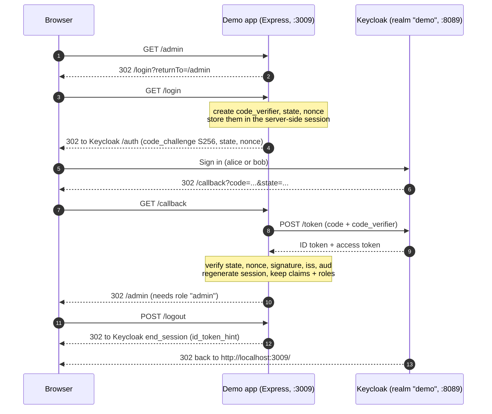

# keycloak-sso-starter

A small, readable starting point for single sign-on with **Keycloak** and **OpenID Connect**.

- `docker compose up` starts Keycloak 26.8.2 with a ready-made `demo` realm (one client, two roles, two users).
- A tiny Express app logs in with **Authorization Code + PKCE**, shows the user's ID token claims and roles, protects `/admin` by role, and logs out through Keycloak's `end_session_endpoint`.
- Tests cover config validation, the role-check middleware, and the full login flow against an in-process mock provider. CI runs them on every push.

> Everything in this repo (passwords, admin account, HTTP, H2 database) is set up for **local development only**. Read [Production hardening](#production-hardening) before you deploy anything based on it.

## Architecture



```
.
├── docker-compose.yml           Keycloak in dev mode, imports ./realm on start
├── docker-compose.postgres.yml  optional override: Postgres instead of H2
├── realm/demo-realm.json        realm "demo": client, roles, users
└── app/                         Express demo app
    ├── src/config.js            env loading + validation (fails fast)
    ├── src/oidc.js              openid-client v6 wrapper: PKCE, state, nonce, logout URL
    ├── src/roles.js             getRoles, requireAuth, requireRole, safeReturnTo
    ├── src/app.js               routes, session cookie, security headers
    ├── test/                    node:test unit + integration tests, mock IdP
    └── e2e/login.e2e.mjs        real-browser login test (Playwright)
```

The app is a **public client**: it has no client secret and relies on PKCE. It keeps tokens in a server-side session and only gives the browser an opaque, `HttpOnly` session cookie.

## Quick start

Requirements: Docker with Compose v2, Node.js 22 or newer.

```bash
# 1. Start Keycloak (first start takes a while; wait until it reports healthy)
docker compose up -d
docker compose ps            # STATUS should become "healthy"

# 2. Configure and start the demo app
cd app
cp .env.example .env         # then set SESSION_SECRET (command is in the file)
npm ci
npm start                    # http://localhost:3009
```

Open http://localhost:3009, click **Log in**, and sign in as one of the demo users below.

| User  | Password         | Realm roles     | `/admin` |
|-------|------------------|-----------------|----------|
| alice | `alice-dev-only` | `user`          | 403      |
| bob   | `bob-dev-only`   | `user`, `admin` | allowed  |

These passwords are committed on purpose so the demo works out of the box. **They are dev-only.** Never import this realm file into a reachable Keycloak.

Keycloak admin console: http://localhost:8089/admin, user `admin`, password `admin-dev-only` (override both in a root `.env`, see `.env.example`).

### Without Docker

`npm run dev:mock` (in `app/`) runs the app against the small mock identity provider used by the tests and prints its URL. It's for working on the app's UI only: the mock accepts any password for `alice`/`bob` and is not a security reference.

## What the realm contains

`realm/demo-realm.json` is imported on startup (`start-dev --import-realm`). If the realm already exists it is skipped, so run `docker compose down` to start fresh.

- **Realm `demo`**: no self-registration, brute-force protection on, 5-minute access tokens, 30-minute SSO idle timeout, 10-hour SSO max, refresh tokens are single-use.
- **Realm roles**: `user`, `admin`.
- **Client `demo-app`**:
  - public client, standard flow (authorization code) only. Implicit flow and direct password grants are off.
  - PKCE required with `S256` (`pkce.code.challenge.method`).
  - redirect URI `http://localhost:3009/callback`, post-logout redirect URI `http://localhost:3009/`. Exact values, no wildcards.
  - protocol mapper "realm roles in roles claim": puts the user's realm roles in a top-level `roles` claim in the ID token, access token and userinfo. Keycloak can also add its own default roles (such as `default-roles-demo`) to that list.
- **Users**: `alice` and `bob` as above.

## Tests

```bash
cd app
npm test
```

This runs, with Node's built-in test runner:

- `test/config.test.js`: required variables, URL checks, https-only outside localhost, session secret length and placeholder detection, boolean and port parsing.
- `test/roles.test.js`: `requireRole` / `requireAuth` behaviour (pass, 401, 403, redirect to login with `returnTo`), claim-path parsing, open-redirect protection, HTML escaping.
- `test/flow.integration.test.js`: the whole login flow through the real app and the real `openid-client` against a mock provider. It checks PKCE S256, state and nonce are sent, session id changes after login, admin vs non-admin access, logout redirect with `id_token_hint`, and that a tampered `state`, a wrong `nonce`, and a callback without a login in progress are all rejected.

### Browser end-to-end test

With Keycloak and the app running:

```bash
cd app
npm install --no-save playwright-core@1.65.0
npm run test:e2e        # uses your installed Google Chrome, headless
```

It logs in as `bob` at desktop and phone widths, checks `/admin` and the claims page, logs out and confirms Keycloak shows the login form again (so the SSO session really ended), then checks `alice` gets a 403. Set `SCREENSHOT_DIR=screenshots` to save screenshots, `APP_URL` if the app isn't on port 3009, and `BROWSER_CHANNEL` to use a different browser.

## Using it with your own app

1. **Create a client** in your realm (or copy `demo-app` from the JSON):
   - server-rendered app or SPA without a backend secret: public client + PKCE S256.
   - backend that can keep a secret: confidential client. In `src/oidc.js`, swap `client.None()` for `client.ClientSecretPost(process.env.OIDC_CLIENT_SECRET)` and keep PKCE on as well.
2. **Register exact URLs**: the redirect URI (`https://your-app/callback`) and the post-logout redirect URI. Avoid `*` wildcards.
3. **Get roles into a token**: either add the same "realm roles" mapper (claim `roles`), or set `OIDC_ROLES_CLAIM=realm_access.roles` and read Keycloak's default layout. For client roles, use the "client roles" mapper and point `OIDC_ROLES_CLAIM` at its claim.
4. **Point the app at it**: set `OIDC_ISSUER=https://sso.example.com/realms/<realm>`, `OIDC_CLIENT_ID`, `APP_BASE_URL`, and a fresh `SESSION_SECRET`.
5. **Protect routes**: `app.get('/reports', requireRole('admin', 'auditor'), handler)` allows either role. `requireAuth` only needs a signed-in user.

The building blocks (`src/roles.js`, `src/oidc.js`) don't depend on the demo pages, so you can copy them into an existing Express app.

## Production hardening

Dev mode is insecure by design. Before you run anything like this for real users:

- **Run Keycloak in production mode**: `start` (not `start-dev`), and build an optimised image (`kc.sh build`) with your options baked in.
- **TLS everywhere**: serve Keycloak and the app over HTTPS only. The app refuses `http://` issuers and base URLs that aren't localhost, and turns on `Secure` cookies when `APP_BASE_URL` is https.
- **Hostname**: set `KC_HOSTNAME` to the public URL (e.g. `https://sso.example.com`) so the token issuer is stable and doesn't depend on request headers. Keep the admin console on a separate, internal hostname (`KC_HOSTNAME_ADMIN`) or block `/admin` at the proxy.
- **Reverse proxy headers**: behind a proxy, set `KC_PROXY_HEADERS=xforwarded` (or `forwarded`) on Keycloak and only accept those headers from the proxy. On the app, set `TRUST_PROXY=true` so Express sees the original protocol.
- **Database**: use Postgres (see `docker-compose.postgres.yml`) or another supported database with backups. Don't use H2.
- **Secrets**: remove the demo users and the realm file's passwords, change the bootstrap admin straight away and create named admin accounts with MFA. Keep `SESSION_SECRET`, database passwords and any client secrets in a secret store, and rotate them. Rotate realm signing keys from **Realm settings > Keys** (add a new key, let old tokens expire, then disable the old one).
- **Token and session lifetimes**: keep access tokens short (5 minutes here), set SSO idle/max timeouts that suit your users, keep refresh-token rotation on, and match the app's session `maxAge` to Keycloak's.
- **Sessions**: replace the in-memory session store with a shared one (Redis, Postgres) so sessions survive restarts and work across several app instances.
- **Realm policies**: add a password policy, require email verification, enable OTP/WebAuthn for admins, and keep brute-force protection on.
- **Health and metrics**: the management port (9000) serves `/health` and `/metrics`. Don't expose it publicly.
- **Keep it updated**: pin the Keycloak image to an exact version and follow the Keycloak security advisories.

## Troubleshooting

| Symptom | Likely cause and fix |
|---|---|
| App exits with "Could not load OIDC discovery" | Keycloak isn't ready yet. Wait for `docker compose ps` to show `healthy`, then start the app again. |
| App exits with "Invalid configuration" | The message lists every problem. Usually `app/.env` is missing or `SESSION_SECRET` is still the placeholder. |
| Keycloak says "Invalid parameter: redirect_uri" | The app's `APP_BASE_URL` doesn't match the client's redirect URI. Both default to `http://localhost:3009`. If you change the port, update the realm too. |
| "Login failed" after signing in | The callback couldn't be verified. Check the app log (`OIDC callback rejected: ...`). Common causes: using `127.0.0.1` in one place and `localhost` in another (cookies are per host), or the issuer URL differing from what the browser used. |
| "Login expired" on `/callback` | The session cookie from `/login` didn't come back: the login was started in another browser/tab, the app restarted (in-memory sessions), or cookies are blocked. |
| Logged out but signing in again doesn't ask for a password | The logout didn't reach Keycloak. Check that `post_logout_redirect_uri` matches the client's "Valid post logout redirect URIs". |
| `/admin` gives 403 for a user who has the role | Look at `/profile` to see which claim the roles are in, and set `OIDC_ROLES_CLAIM` to match. Roles are read at login, so log out and in again after changing them. |
| Realm changes in the JSON are ignored | Import skips realms that already exist. `docker compose down` and `up` again (or `down -v` with Postgres). |
| Port 8089 or 3009 already in use | Set `KEYCLOAK_PORT` in the root `.env` and/or `PORT` + `APP_BASE_URL` in `app/.env`, and update the client's URLs. |

## License

[MIT](LICENSE) © Shan Qayyum
